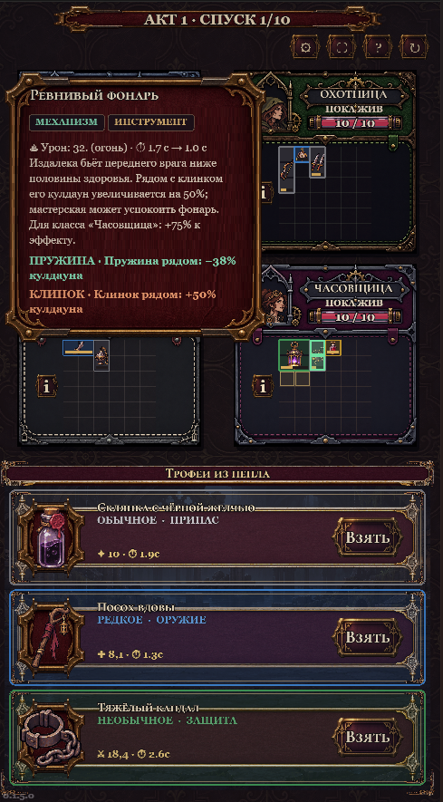

# Woundbound — визуальный разбор экрана «Трофеи из пепла»

**Кадр от 18 ноября 2026, 489 × 885 пикселей.** Акт 1, спуск 1/10. Открыта подсказка «Ревнивый фонарь» в рюкзаке Часовщицы. Разбор относится к тому, что игрок видит в этом кадре. Координата Y отсчитывается от верхнего края.

## Исправить в первую очередь

| № | Что видно в масштабе игры | Что считать исправлением |
|---|---|---|
| 1 | **Золото перечёркивает названия всех трёх наград.** На «Склянке с чёрной желчью», «Посохе вдовы» и «Тяжёлом кандале» верхняя горизонтальная рейка проходит сквозь буквы примерно на Y = 562, 672 и 783. Под названием и типом при этом остаётся свободное место. | Разместить текстовый блок целиком внутри бордового поля. Между видимой верхушкой букв и нижней гранью рейки оставить хотя бы 4 пикселя в этом размере. Проверять также длинные названия. |
| 2 | **Статусы героев выпали из именных табличек.** У Охотницы и Часовщицы имя находится на тёмном металле, а «ПОКА ЖИВ» лежит ниже него. Через середину букв проходит центральный зубец орнамента. До стекла HP остаётся узкая щель. | Задать общую внутреннюю область для двух строк. Вместить туда имя и статус с просветом между ними. Если при текущем масштабе высоты мало, увеличить саму табличку. Проверять по контурам букв, центральному зубцу и стеклу HP. |
| 3 | **Текст подсказки попадает в угловые завитки.** Первая буква заголовка «Ревнивый фонарь» вплотную к верхнему левому завитку. Нижний левый завиток заходит под слово «кулдауна» в последней оранжевой строке. Ровная центральная часть рамки оставляет ложное впечатление, что места достаточно. | Определить отступ от наиболее выступающей части каждого угла. Рассчитывать высоту окна после переноса последней строки. Вокруг первой и последней букв должен оставаться виден сплошной бордовый фон. |

## Подсказка фонаря

| № | Наблюдение | Направление правки |
|---|---|---|
| 4 | Панель занимает приблизительно 285 × 295 пикселей. Она закрывает почти всю верхнюю левую карточку, шапку нижней левой и край правой колонки. Курсор на снимке не виден, а между панелью и фонарём нет явной визуальной связи. | Сохранить видимыми предмет и соседние клетки, эффекты которых объясняет окно. Выбирать положение по доступному месту и привязывать панель к стороне исходного предмета. |
| 5 | Урон и изменение интервала записаны одной строкой как «Урон: 32. (огонь) · … 1.7 с → 1.0 с». Точка разрывает число и тип урона. Стрелка сообщает об изменении, но её значения приходится расшифровывать по тексту ниже. | Сгруппировать «32 огненного урона» и «Интервал 1,7 → 1,0 с». Дать числам больший вес и использовать один формат десятичных дробей с наградами. |
| 6 | Дальность удара, условие здоровья, влияние клинка, успокоение в мастерской и бонус класса набраны почти одинаково. Строка «Для класса „Часовщица“: +75% к» распадается так, что «эффекту» занимает отдельную строку. | Развести боевой эффект, условие мастерской и бонус класса. Компактная запись «Часовщица · эффект +75%» помещается отдельно и читается быстрее. |
| 7 | В цветных строках повторяются «ПРУЖИНА · Пружина рядом» и «КЛИНОК · Клинок рядом». Правило про клинок уже есть в абзаце выше. Повторы отнимают ширину, из-за чего слово «кулдауна» дважды переносится в одиночку. | Объединить обе связи под подписью «Соседство». По одной строке на тип, например «Пружина · интервал −38%» и «Клинок · интервал +50%». |
| 8 | Зелёный и оранжевый выделяют два правила, но по самой подсказке трудно определить, какое из них сработало в текущей раскладке. Те же насыщенные оттенки используются для редкости и выделения клеток. | Показывать активное соседство отдельной меткой рядом с правилом и повторять эту метку у соответствующей клетки. Смысл должен сохраняться без различения оттенков. |

## Награды и выбор предмета

| № | Наблюдение | Направление правки |
|---|---|---|
| 9 | Название и редкость скучены сверху, между редкостью и характеристиками широкая пустая полоса. В результате три короткие строки занимают почти всю высоту каждой рамки, но читать карточку как единое целое трудно. | Собрать название, тип и характеристику в один вертикальный блок с измеренными межстрочными интервалами. Центрировать блок между внутренними рейками. |
| 10 | У склянки и посоха строка сводится к маленькому светлому знаку, числу и часам. По виду трудно отличить лечение от урона кандала. Мелкие пиктограммы теряются рядом с золотым текстом. | Писать короткое название эффекта перед числом, например «Лечение 10». Разнести величину эффекта и интервал, выровнять эти группы одинаково у всех трёх вариантов. |
| 11 | У синего «РЕДКОЕ» и зелёного «НЕОБЫЧНОЕ» тёмный цвет и мелкие засечки. На бордовой подложке обе строки читаются хуже светлого «ОБЫЧНОЕ». | Дать подписям светлые оттенки той же редкости. Цветовую метку оставить видимой и при беглом сравнении предметов. |
| 12 | Вокруг каждой награды одновременно видны внешний цветной контур, тёмная полоса, светлая рейка, угловые накладки и отдельная рама предмета. Три ряда образуют череду ярких горизонталей. Названия и характеристики уступают им по контрасту. | Оставить более спокойный общий контур, цвет редкости сосредоточить у предмета. Сохранить готические углы за пределами области текста. |
| 13 | Сами иконки различимы, но двойные рамки отнимают у них место. Низ склянки и древко посоха почти касаются основания витрины, а тёмное звено кандала теряется на её тёмной подложке. | Вписывать видимый силуэт в свободную область витрины с равным оптическим зазором. Проверить отдельно высокий посох, широкое звено и светлый блик стекла. |
| 14 | «Взять» контрастнее и крупнее названия предмета. Слева и справа от слова мало бордового поля из-за внутренних завитков. На трёх одинаковых кнопках взгляд задерживается раньше, чем на различиях между наградами. | Сохранить удобную область нажатия. Дать надписи боковой воздух и снизить контраст декора кнопки, чтобы первым читалось название награды. |

## Планшеты, шапка и нижний край

| № | Наблюдение | Направление правки |
|---|---|---|
| 15 | Границы пустых клеток почти исчезают в тёмном дне. У Охотницы особенно трудно увидеть, где заканчивается сетка справа и начинается свободная стенка ниши. Очертания занятых ячеек, наоборот, очень резкие. | Слегка усилить гравировку и обозначить внешний периметр рабочей сетки. В игровом размере должно быть возможно сосчитать шесть столбцов до наведения. |
| 16 | У фонаря одновременно видны зелёный фон, яркая светлая обводка соседних квадратов и пустые золотистые контуры ниже. На статичном кадре трудно отличить сам выбранный предмет, подходящее свободное место и фактическую связь. | Развести эти три состояния формой или типом обводки. У занятой подходящим предметом клетки оставить читаемым его силуэт. |
| 17 | Цифры «10 / 10» на узких колбах почти заполняют высоту стекла. Верхняя и нижняя светлые кромки конкурируют с белыми штрихами цифр. Кнопки информации слева от рюкзаков выглядят как самостоятельные предметы в рамочках. | Дать цифрам ровный фон и вертикальный зазор внутри стекла. Привязать значок информации к краю планшета так, чтобы он считывался как действие над героем. |
| 18 | В верхнем правом ряду знак полноэкранного режима, вопрос и перезапуск темнее своих золотых обводок. Под плашкой акта слева пусто, а справа сразу четыре равных мелких рамки. | Поднять контраст и унифицировать толщину штриха пиктограмм. Сбалансировать строку управляющих кнопок относительно центрированной плашки акта. |
| 19 | У заголовка «Трофеи из пепла» тонкий текст внутри длинной орнаментальной полосы. Внизу последняя карточка, внешний угол секции и серая версия игры сходятся у края экрана. Версию трудно разобрать поверх декора. | Ослабить кромки разделителя, оставить заголовку чистый фон. Зарезервировать для версии отдельную нижнюю строку с просветом до последнего уголка. |

## Как принять исправления

1. Повторить этот кадр в размере **489 × 885** и посмотреть его в масштабе **100%**. Сначала закрыть подсказку и проверить все три названия наград, обе строки каждой именной таблички и нижний край экрана.
2. Открыть «Ревнивый фонарь» с двумя строками соседства. Проверить первую букву заголовка, последнюю строку, видимость фонаря и возможность сопоставить каждое правило с клеткой.
3. Повторить с длинным статусом куклы и самым длинным названием награды на **360 × 640** и в альбомном окне **800 × 450**. Это дополнительные размеры для проверки будущих исправлений. Наблюдения выше относятся к приложенному портретному кадру.

## Проверка итерации 20 ноября 2026

Проверено локально во встроенном браузере Codex при **492 × 883**: начальный экран, бой 1/10, карточки наград и подсказка клинка с активным точильным камнем. `npm run typecheck` и `npm run build` прошли. Тестовый harness не запускался.

| Пункты | Состояние | Проверка |
|---|---|---|
| 1–3 | Исправлены | Названия наград не пересекают рейки; статус помещается в табличку; у заголовка подсказки и нижнего эффекта есть отступ от углов. |
| 4 | Улучшен | Подсказка следует за предметом и не закрывает его или соседний предмет синергии. На портретном экране она всё ещё перекрывает часть остальных карточек — свободной области под ней нет. |
| 5–7 | Исправлены | Урон и интервал разделены; бонус класса вынесен в отдельную строку; повтор синергии удалён из описаний и оставлен в одной строке правила. |
| 8 | Исправлен | Активная связь отмечена галочкой в подсказке и на ячейке соседнего предмета; неактивная связь получает ромб. |
| 9–12, 14–16, 18–19 | Исправлены и перепроверены | Блоки наград собраны плотнее, редкость светлее, контуры спокойнее, CTA приглушена, сетка читается, отметка синергии отличает активную связь, верхние значки ярче, версия поднята от нижней кромки и получила тёмную обводку. |
| 13 | Частично проверен | Три текущих награды помещаются в витрины без видимого обрезания. Проверка альфа-краёв всех предметных атласов в эту итерацию не проводилась. |
| 17 | Улучшен | HP остаётся читаемым; значок информации увеличен и придвинут к левому борту планшета, на высоте центра рюкзака. |

Размеры **360 × 640** и **800 × 450** не перепроверялись; пункты 13 и 17 требуют отдельной проверки там и осмотра полного набора спрайтов.

## Проверка итерации 21 ноября 2026

| Пункты | Состояние | Проверка |
|---|---|---|
| 4 | Исправлен для портретной раскладки | Подсказка предмета привязывается к фактическому началу боевой зоны (`field.y`), ниже планшетов и заголовка комнаты; на широких экранах сохраняется размещение у стороны предмета. Её вертикальные отступы уплотнены, чтобы лучше вписать панель в область боя. |
| 13 | Исправлен в проверенных атласах | Четыре классовых атласа прошли `node scripts/validate-pixel-assets.mjs --class-items`: RGBA, 16 прозрачных кадров на атлас, исходники сохранены. Атласы осмотрены визуально; белых ореолов и обрезанных силуэтов не обнаружено. |
| 17 | Исправлен | Значок информации увеличен и привязан к левому краю планшета на высоте центра сетки; цифры HP остаются читаемыми внутри шкалы. |

Для этого релиза также упрощены подписи соседних синергий: название связи и бонус теперь читаются одной короткой строкой, без повторения описания предмета. Проверено: `npm run typecheck`, `npm run build`; тестовый harness не запускался. Портретная раскладка проверена во встроенном браузере при 492 × 883; новый расчёт позиции использует начало поля, которое в этом размере находится ниже всех четырёх планшетов и заголовка комнаты. Размеры 360 × 640 и 800 × 450 остаются вне фактической визуальной проверки.
